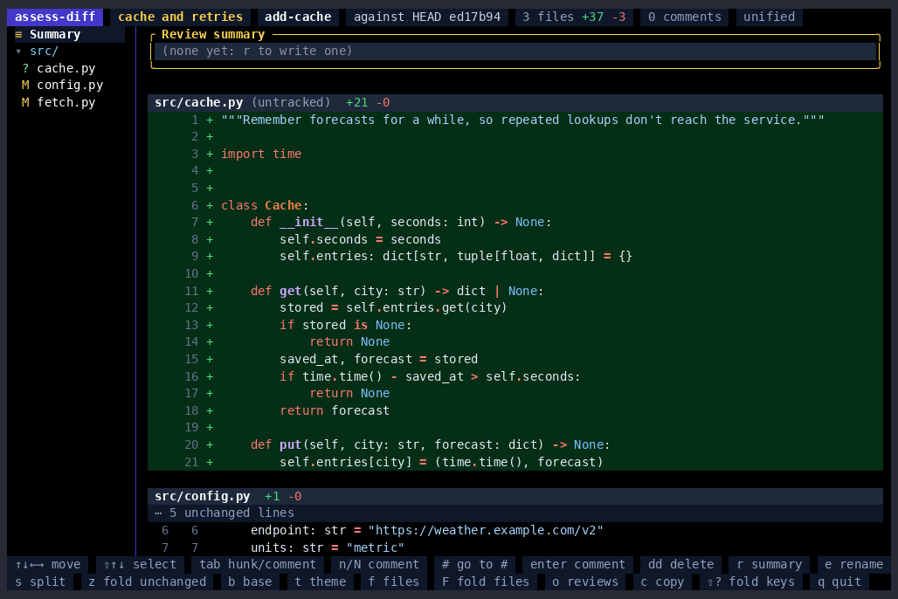

# assess-diff

Review an agent's working-tree diff in the terminal while it's still working,
and hand the review back to it as Markdown.

`assess-diff` shows every changed file whole, in one scroll, reloading as files change.
You comment on any line or range, write a summary,
and copy the review (`c`) to paste into the agent, comments in the order you wrote them,
each with a `path:line` reference,
and the lines it was about where they've changed since.
Reviews are saved as you type, under `$XDG_DATA_HOME/assess-diff/`,
and belong to the repository, across its worktrees.



It's built on [counterweight](https://www.counterweight.dev/).

## Running it

```bash
uv tool install assess-diff
assess-diff              # review this worktree's changes since HEAD (b switches to the merge base)
assess-diff --base main  # review them against the merge base with main
assess-diff --help       # the other commands: list, show, delete
```

The footer lists the keys for whatever you're doing.
Everything works with the mouse too:
click a line to move there (Shift+click to select), a comment to edit it, a file in the picker to jump to it.

## Reviewing

The diff is against `HEAD`, the change since the last commit,
or, with `b`, against the merge base with the default branch, the whole branch as a pull request would show it.
The default branch is what `origin/HEAD` points at, or else a local `main` or `master`;
`--base` names another, and starts a new review on it.
A resumed review keeps the base it was last viewed against.

Tab and Shift+Tab jump between hunks and comments, and `n` and `N` between comments alone.
The file picker on the left (`f`) jumps to a file, and `/` there narrows it to the paths matching what you type.
`s` switches between the unified and split views, and `t` picks a syntax theme, previewing each as you go.
Both are kept as preferences, under `$XDG_CONFIG_HOME/assess-diff/`.

Enter comments on the selected lines, or, on a file's header, on the whole file.
Comments are numbered in the order you write them, and numbers are never reused,
so one comment can refer to another as `#3`, and `#` goes to a comment by its number.
When the agent changes the lines a comment was about, the comment is marked outdated
and keeps the lines as they were.
`r` writes the summary, a top-level comment like a pull request review's.

## Reviews

Running `assess-diff` resumes this worktree's most recently updated review, or starts one.
`o` opens the review manager, to start a new review, open, rename, or delete one,
across every worktree of the repository.
Each review is one JSON file in `$XDG_DATA_HOME/assess-diff/reviews/`
(`~/.local/share/assess-diff/reviews/` when that's unset),
named by an id that `--review`, `show`, and `delete` accept any unambiguous start of, as git takes a commit.
Nothing deletes a review but you.

Every edit is saved before it's drawn, so a crash or a stray Ctrl+C loses nothing.
If two `assess-diff`s have the same review open, the second to save keeps its version as a new review and says so,
rather than overwriting the other's.

A repository's reviews are found by the path of its git directory,
so moving or re-cloning it leaves its earlier reviews listed under the old path.

## The Markdown

`c` copies the review, and `assess-diff show` prints it, which an agent can run itself:

````markdown
# Review of `my-branch` against `main` (merge base `abc1234`)

The summary.

## 1. `src/app.py:42-45`

A comment on lines 42 to 45.

## 2. `src/old.py`, removed lines 10-12 (in `abc1234`)

A comment on lines the change removes.

## 3. `src/handler.py:7`

_These lines have changed since this comment was written; the excerpt shows them as they were._

```diff
-    return None
+    return compute()
```

An outdated comment.

## 4. `src/views.py`

A comment on the whole file.
````

Copying uses OSC 52, which most terminals support;
under tmux it needs `set -g set-clipboard on`.

## Developing

See [`CLAUDE.md`](CLAUDE.md) for the commands and conventions.
